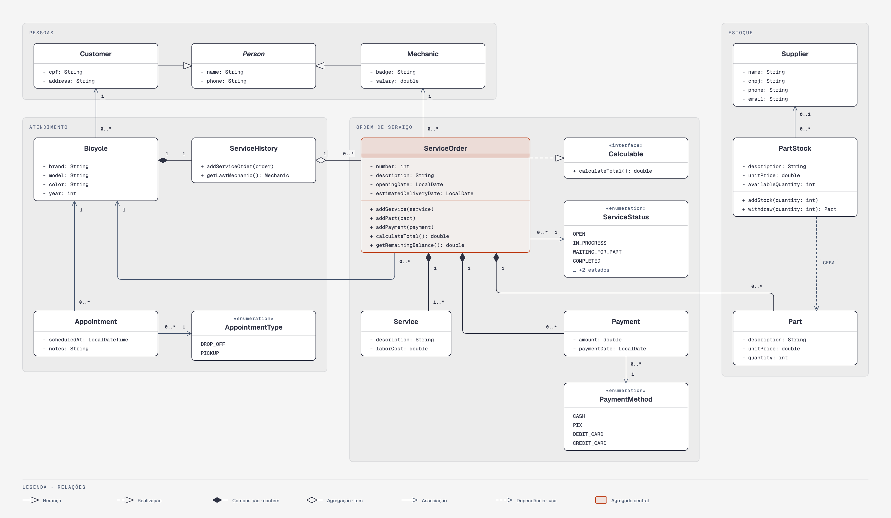

# Oficina de Bicicletas

Aplicação Java inicial para cadastro de clientes, mecânicos e bicicletas, bem como abertura e consulta de ordens de serviço. Nesta fase inicial da implementação, os dados ficam em memória durante a execução. Posteriormente, com o andamento do projeto os dados serão armazenados em arquivo.

## Diagrama de classes



- Versão editável: [docs/class-diagram.html](docs/class-diagram.svg).
- Editor: [digstdio](https://fernandohaeser.github.io/diagram-studio/#/app)

## Modelagem proposta (inicial)

### Herança

```text
             Person (abstrata)
              /          \
         Customer      Mechanic
```

`Person` concentra os dados comuns (nome e telefone). `Customer` acrescenta CPF e endereço; `Mechanic` acrescenta matrícula e salário.

### Associações e responsabilidades

- Um `Customer` pode ter várias bicicletas; cada `Bicycle` cadastrada pertence a um cliente.
- Uma `ServiceOrder` registra a bicicleta atendida, o mecânico responsável, a descrição, as datas, o status, a mão de obra e as peças utilizadas.
- `ServiceStatus` enumera os estados iniciais: `OPEN`, `IN_PROGRESS`, `WAITING_FOR_PART`, `UNDER_REVIEW_AND_TESTING`, `WAITING_FOR_PICKUP` e `COMPLETED`.
- `Service` representa cada serviço realizado (revisão, troca de freio etc.), com descrição e valor da mão de obra. Uma `ServiceOrder` tem um ou mais serviços, e a mão de obra da ordem é a soma deles.
- `Part` representa um item e sua quantidade na ordem de serviço.
- `PartStock` controla o estoque de cada peça (quantidade disponível, preço e `Supplier`). A baixa (`withdraw`) valida o saldo e devolve um `Part` pronto para ser adicionado à ordem.
- `Supplier` guarda os dados dos fornecedores de peças.
- `Payment` registra valor, data e forma de pagamento (`PaymentMethod`). A ordem rejeita pagamentos que excedam o saldo restante.
- `Appointment` registra agendamentos de entrada ou retirada (`AppointmentType`) de uma bicicleta.
- `ServiceHistory` mantém o histórico de ordens de uma bicicleta e informa o último mecânico que a atendeu.
- `Calculable` é implementada por `ServiceOrder`, que calcula a mão de obra dos serviços mais o valor das peças.
- `Model` será extraída em uma próxima etapa. Por enquanto, a bicicleta guarda marca e modelo como textos.

### Regras previstas para evolução

- O prazo inicial da ordem é de cinco dias a partir da abertura.
- Se for necessário solicitar uma peça ao revendedor, a ordem deve passar para `WAITING_FOR_PART` e a previsão deve ser atualizada.
- A atribuição automática deve priorizar o mecânico que atendeu anteriormente a bicicleta, caso esteja disponível; caso contrário, deve escolher um mecânico livre.
- A disponibilidade dos mecânicos, a extensão do prazo por espera de peças e a persistência dos dados ainda precisam ser implementados.

## O que já funciona

O menu de terminal permite cadastrar e listar clientes, mecânicos e bicicletas, abrir ordens de serviços (com um ou mais serviços) e consultar as ordens. Cada ordem aberta entra no histórico da bicicleta. Fornecedores, estoque, pagamentos e agendamentos já têm modelo, mas ainda não têm opção no menu. Os cadastros e as ordens usam `ArrayList` e são perdidos ao encerrar o programa.
